# Support Guidance Assistant — Architecture

This page shows the target architecture described in [claude.md](claude.md): diagrams first, then the key decisions and why they were made.

**Contents**
1. [System context](#1-system-context)
2. [Components and layering](#2-components-and-layering)
3. [Ingestion and compilation](#3-ingestion-and-compilation)
4. [Guideline version lifecycle](#4-guideline-version-lifecycle)
5. [Chat harness (LangGraph)](#5-chat-harness-langgraph)
6. [Chat request with tools and approval](#6-chat-request-with-tools-and-approval)
7. [Hybrid intent routing](#7-hybrid-intent-routing)
8. [Capabilities and bindings](#8-capabilities-and-bindings)
9. [Data model](#9-data-model)
10. [Deployment](#10-deployment)
11. [Key decisions](#11-key-decisions)

---

## 1. System context

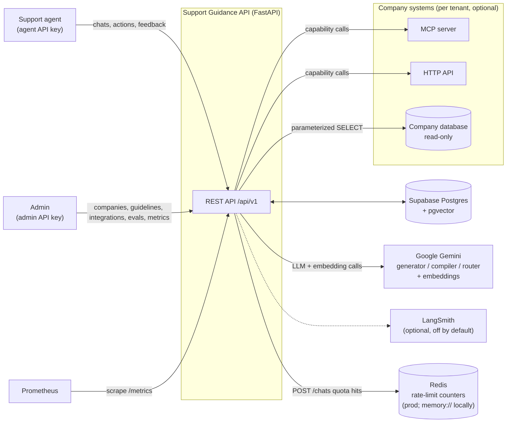

---

## 2. Components and layering

Dependencies only point downward. Routers hold no business logic or SQL, services never import FastAPI, and only the adapters know about MCP, HTTP or company databases.

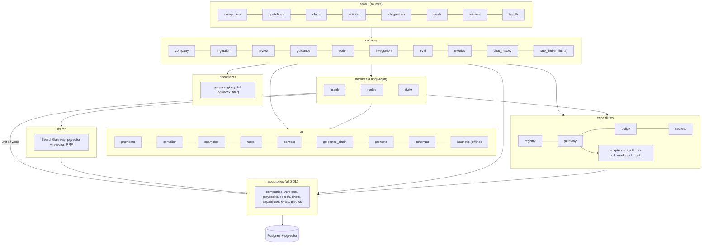

---

## 3. Ingestion and compilation

Ingestion is one pure async function with no FastAPI imports, so it can move to a worker queue unchanged. It is deliberately not a graph.

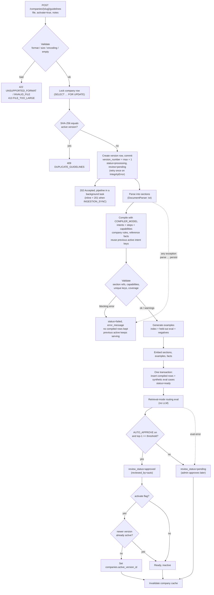

---

## 4. Guideline version lifecycle

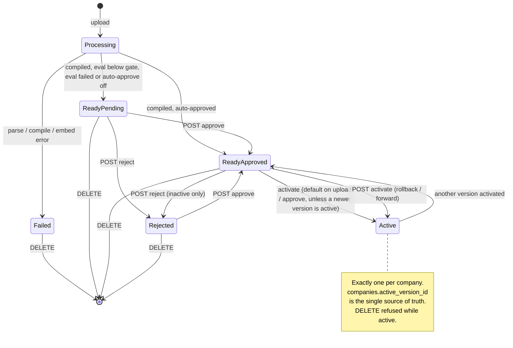

---

## 5. Chat harness (LangGraph)

The graph (`harness/graph.py`) is built once at startup and runs in-process. Each node is a plain async function, so it can be unit-tested without the graph. There is no checkpointer: one chat is one graph run. Before the graph runs, `GuidanceService` resolves the company context; a missing company (404) or no usable active version (409 `NO_ACTIVE_GUIDELINES`) is returned without running the graph.

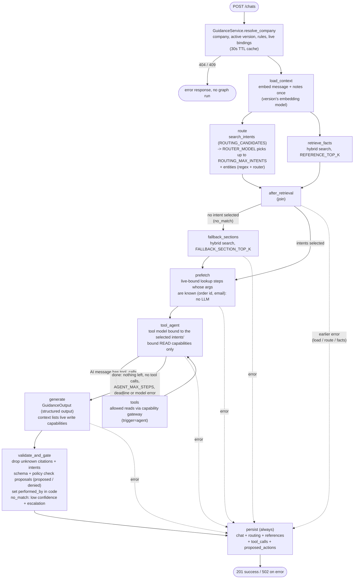

Every node is wrapped by `guarded()`: an exception is recorded in `errors`, later nodes are skipped and the run ends in `persist`, so the chat row is stored with `status=error`. The service then maps router or generator failures to `502 LLM_ERROR` and search failures to `502 RETRIEVAL_ERROR`. Tool failures never fail a chat; the step just becomes manual.

`performed_by` on each plan step:

| Value | Meaning |
|---|---|
| `ai` | Say / ask steps folded into the drafted reply |
| `ai_verified` | Lookup the harness actually ran (links a `tool_call_id`) |
| `needs_approval` | Write proposed as an action (links a `proposed_action_id`) |
| `agent` | Manual: unbound, failed or timed-out lookups and actions, escalations |

---

## 6. Chat request with tools and approval

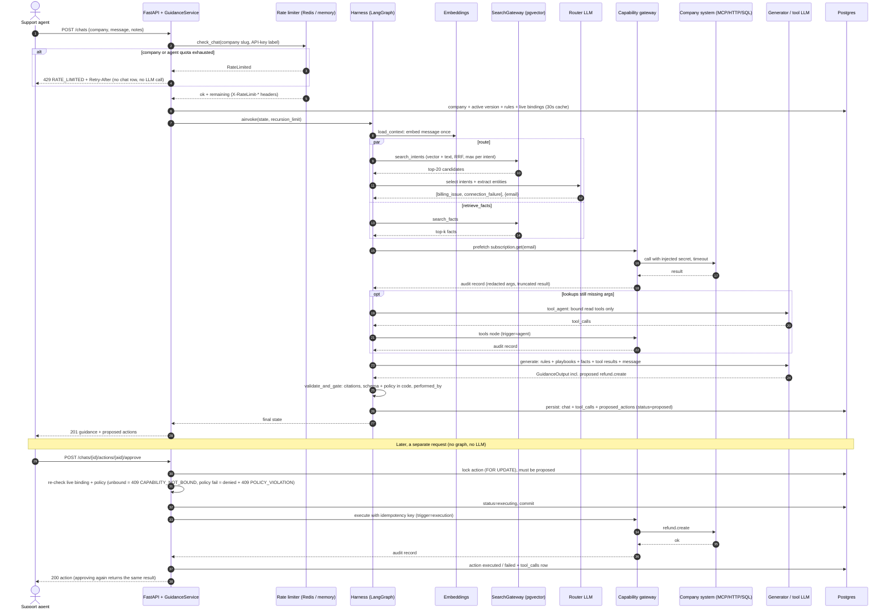

### Rate limiting
`POST /chats` is the expensive endpoint (embeddings, two LLM calls, tool calls), so the router checks quotas with the [`limits`](https://limits.readthedocs.io) library (`services/rate_limiter.py`) **after** auth and body validation and **before** the service runs. The company slug is in the JSON body, so this can't be done in middleware.

| Level | Key | Default | Purpose |
|---|---|---|---|
| Per agent per company | `("chat", "agent", slug, API-key label)` | `CHAT_RATE_LIMIT_PER_AGENT=20/minute` | One agent or script can't flood a tenant |
| Per company | `("chat", "company", slug)` | `CHAT_RATE_LIMIT_PER_COMPANY=300/minute` | Caps one tenant's total LLM spend |

- The company quota is tested first, then the agent quota is hit, then the company quota. A request rejected at one level doesn't use up quota at the other.
- Strategy: sliding-window counter by default (`moving-window` and `fixed-window` can be configured). Several windows per level are allowed (`20/minute;300/hour`).
- Rejected requests get `429 RATE_LIMITED`, `Retry-After` and `details.scope`. They aren't stored as chats but count in `chat_rate_limited_total{company,scope}`.
- Storage: `memory://` per process (local, tests), Redis in production so all replicas share counters.
- If Redis is unreachable, chats are allowed (`RATE_LIMIT_FAIL_OPEN=true`) and a warning is logged.
- An agent is identified by the label of their API key, so agents sharing a key share one quota.

---

## 7. Hybrid intent routing

The router never sees the full intent list, only about 20 candidates. That is what lets this scale to hundreds of intents per company.

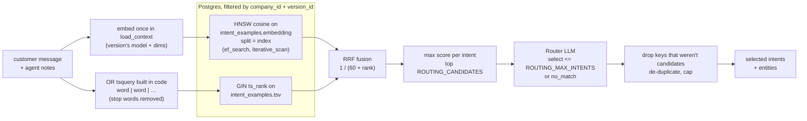

Facts and fallback sections use the same two arms and RRF, without the per-intent step. The offline router and retrieval evals use a retrieval-only no-match rule instead of the LLM: no candidates, or no keyword hit and best cosine similarity below `ROUTING_MIN_SCORE`.

---

## 8. Capabilities and bindings

Playbook steps refer to abstract capabilities. Each company decides how, or whether, each one is implemented.

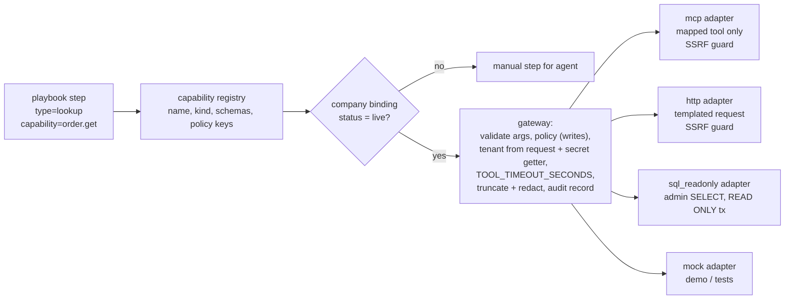

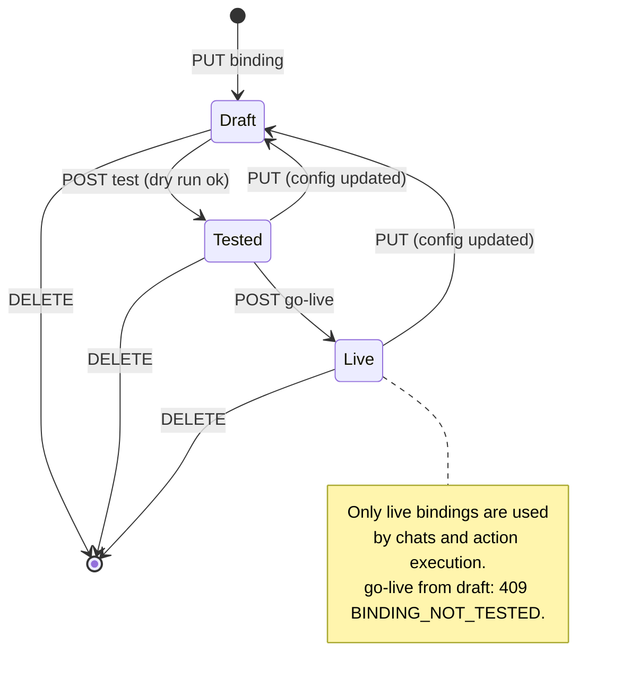

Proposed action lifecycle:

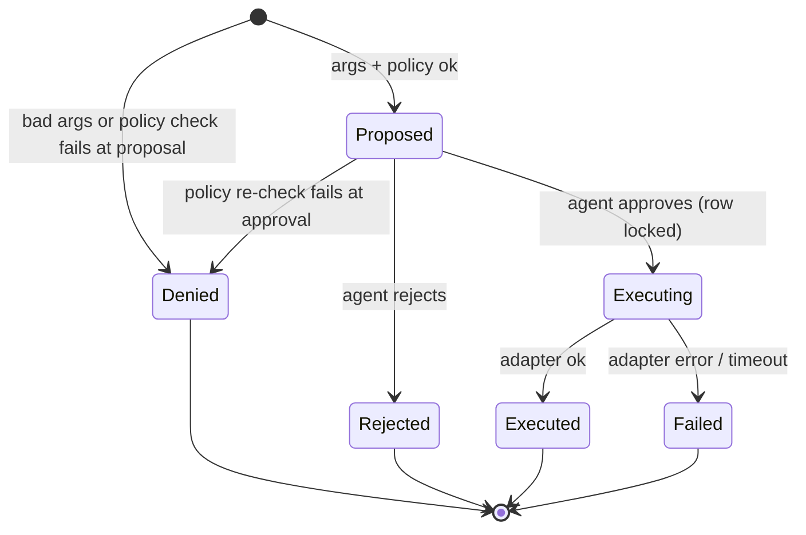

Proposals for unknown, read-only or unbound capabilities are not stored; the step becomes manual (`performed_by: "agent"`).

---

## 9. Data model

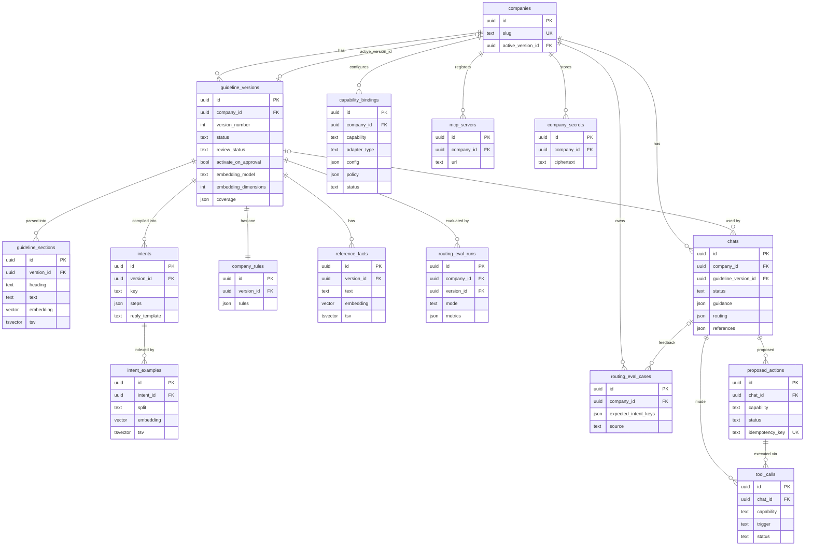

All playbook tables carry `company_id` + `version_id` and cascade on version delete, so deleting a version also deletes its vectors.

---

## 10. Deployment

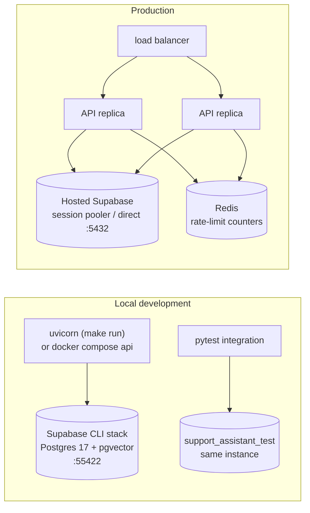

The API process is stateless (all durable state lives in Postgres, shared rate-limit counters in Redis), so it scales horizontally. Locally the limiter uses in-process memory and needs no Redis. Only env vars differ between environments.

---

## 11. Key decisions

| # | Decision | Why | Alternatives considered | Trade-off |
|---|---|---|---|---|
| 1 | **Compile guidelines into structured playbooks at upload** | Guidelines are runbooks for humans. Turning them into intents, typed steps, rules and facts makes routing exact, makes steps citable, and links steps to tools. | Plain RAG over chunks | Needs an LLM compile step plus validation; mistakes there need a coverage check and an optional human review |
| 2 | **pgvector in the same Postgres; Chroma removed** | One store, one transaction, one backup. Tenant and version filters in SQL; cascade deletes. Hundreds of intents per company is small for pgvector. | Chroma, a dedicated vector DB | At very large scale, pgvector needs partitioning; `SearchGateway` keeps a swap possible |
| 3 | **Hybrid search (vector + full-text, RRF)** | Embeddings miss product names, codes and exact phrasing; keyword search catches them | Vector only | Two queries per search; both indexed and cheap |
| 4 | **Embed synthetic example messages per intent; score by best match** | Customer wording rarely matches an intent's name or description | Embedding the intent description | More rows and embedding cost at ingest |
| 5 | **Two-stage routing: search candidates, then a cheap LLM selects** | Scales to hundreds of intents (the router sees about 20); handles messages with several intents and no-match | Single classifier over all intents; vector top-1 | One extra (fast) LLM call per chat |
| 6 | **Company rules always injected, never retrieved** | Tone, sign-off and prohibitions apply to every reply; retrieval could drop them | Retrieve as chunks | Slightly larger prompt |
| 7 | **Reference facts as a separate retrieval index** | Prices, device lists and URLs aren't procedures and don't map to steps | Folding facts into intents | A second search per chat (runs in parallel) |
| 8 | **Stable intent keys across versions** | Metrics, evals, feedback and history stay comparable after re-uploads | New keys per version | Compiler must be given previous keys; covered by a test |
| 9 | **Immutable versions; single active pointer on `companies`** | Exactly one active version, instant rollback with no re-indexing | `is_active` flag on versions | Activation needs a row lock (`FOR UPDATE`) |
| 10 | **Auto-approve by default, gated by a retrieval eval** | Zero friction for normal uploads, but a poor compile doesn't go live silently | Always manual review; always auto | Gate threshold needs tuning per domain |
| 11 | **Routing evals keyed by intent key, run per version** | Lets you compare two guideline versions before a rollback; agent feedback becomes test data | Ad-hoc manual testing | Synthetic cases can be easier than real traffic, which feedback cases offset |
| 12 | **Abstract capabilities + per-company bindings (MCP / HTTP / read-only SQL / mock)** | Guidelines stay vendor-neutral; companies go live with zero integrations and add automation one binding at a time | Hard-coded vendor APIs; giving the model a whole MCP server | Admins must map tools to capabilities and test each binding |
| 13 | **Reads automatic, writes only as approved proposals** | Side effects stay under human control; the harness executes once with an idempotency key | Letting the model execute writes | One extra click for the agent |
| 14 | **Policy enforced in code, at proposal and at execution** | Prompts can be bypassed; code can't | Policy in the prompt | Policy keys must exist in the capability registry |
| 15 | **Read-only SQL only via admin-defined, parameterized SELECTs** | Reaches company databases without model-written SQL or write risk | Text-to-SQL | Each query must be defined up front |
| 16 | **Graceful degradation everywhere** | A broken or missing integration turns a step into a manual step instead of failing the chat; only an LLM failure returns 502 | Failing the request | Guidance may be less automated, never unavailable |
| 17 | **LangGraph for the chat harness, run in-process** | Branching, a bounded tool loop, parallel nodes and per-node tracing in one place; no extra service | Hand-written orchestration; LangGraph Platform | New dependency; nodes kept as plain functions to limit coupling |
| 18 | **No LangGraph checkpointer; approval is a separate deterministic request** | Paused graph state would have to live for minutes in storage; executing an approved action needs no LLM | `interrupt()` + Postgres checkpointer | The graph can't resume a conversation (multi-turn is out of scope) |
| 19 | **Ingestion is a plain async function, not a graph** | It's linear; plain code is simpler and moves to a worker queue unchanged | LangGraph for ingestion | None significant |
| 20 | **Alembic owns the schema; Supabase only hosts it** | One migration history for local, CI and prod; CI can use plain pgvector Postgres | Supabase migrations / Studio | Supabase-specific features aren't used |
| 21 | **Secrets encrypted (Fernet) behind `SecretStore`; injected at call time** | Credentials never reach prompts, logs or the audit table | Plaintext config | Key management via env var until KMS/Vault |
| 22 | **Everything external is untrusted data** | Customer messages, guidelines and tool output are all delimited and can't change instructions (prompt-injection defence) | — | Prompt is a bit more verbose |
| 23 | **LangSmith tracing off by default** | Tracing would send customer messages and tool data to a third party | Always on | Opt-in through env vars when debugging |
| 24 | **Chat rate limits per agent per company and per company, using `limits` in the router; Redis in production** | The company slug is in the body, so the check runs after parsing and before any LLM spend. `limits` has async storage, several algorithms and swappable backends (memory locally, Redis shared across replicas). | slowapi (key function only sees the request, not the body); fastapi-limiter (Redis only); gateway/edge limits (can't see company or agent); a Postgres counter table | Adds Redis in production. Fails open on Redis errors, so limits can lapse during an outage. "Agent" means API-key label. |

### Out of scope (future work)
Multi-turn threads, SSO/RBAC, a queue worker, multilingual messages, PDF/DOCX/OCR parsers (the interface exists), native OAuth connectors (Shopify, Stripe, Zendesk) and OpenAPI import, KMS/Vault, per-company tool rate limits, cross-encoder re-ranking, LLM-judge reply evals, partitioning by company, streaming responses.
