# Support Guidance Assistant — Architecture (v2)

This page shows the target architecture described in [claude.md](claude.md) (the v2 spec): diagrams first, then the key decisions and why they were made.

**Contents**
1. [System context](#1-system-context)
2. [Components and layering](#2-components-and-layering)
3. [Ingestion and compilation](#3-ingestion-and-compilation)
4. [Guideline version lifecycle](#4-guideline-version-lifecycle)
5. [Chat harness (LangGraph)](#5-chat-harness-langgraph)
6. [Chat request with tools and approval](#6-chat-request-with-tools-and-approval)
7. [Hybrid intent routing](#7-hybrid-intent-routing)
8. [Capabilities and bindings](#8-capabilities-and-bindings)
9. [Data model](#9-data-model)
10. [Deployment](#10-deployment)
11. [Key decisions](#11-key-decisions)

---

## 1. System context

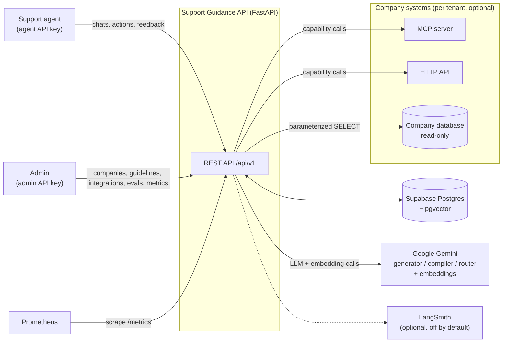

---

## 2. Components and layering

Dependencies only point downward. Routers hold no business logic or SQL, services never import FastAPI, and only the adapters know about MCP, HTTP or company databases.

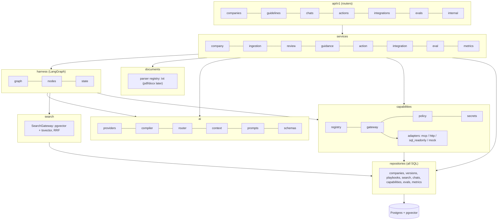

---

## 3. Ingestion and compilation

Ingestion is one pure async function with no FastAPI imports, so it can move to a worker queue unchanged. It is deliberately not a graph.

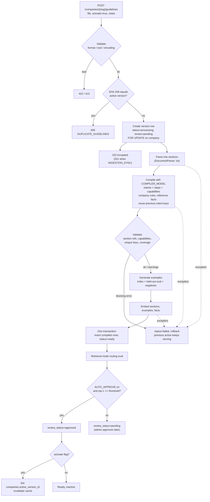

---

## 4. Guideline version lifecycle

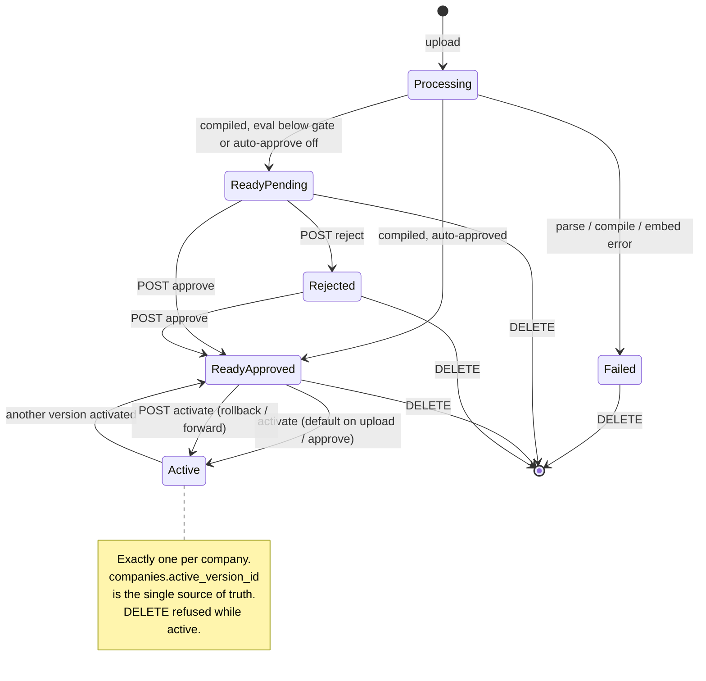

---

## 5. Chat harness (LangGraph)

The graph is built once at startup and runs in-process. Each node is a plain async function, so it can be unit-tested without the graph. There is no checkpointer: one chat is one graph run.

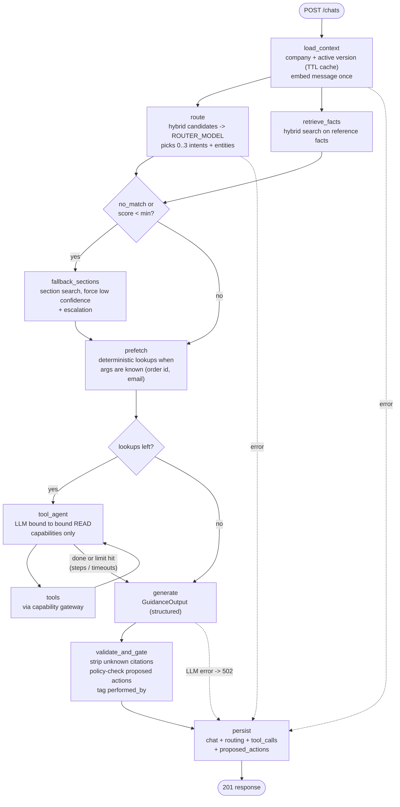

`performed_by` on each plan step:

| Value | Meaning |
|---|---|
| `ai` | Say / ask steps folded into the drafted reply |
| `ai_verified` | Lookup the harness actually ran (links a `tool_call_id`) |
| `needs_approval` | Write proposed as an action (links a `proposed_action_id`) |
| `agent` | Manual: unbound, failed or timed-out lookups and actions, escalations |

---

## 6. Chat request with tools and approval

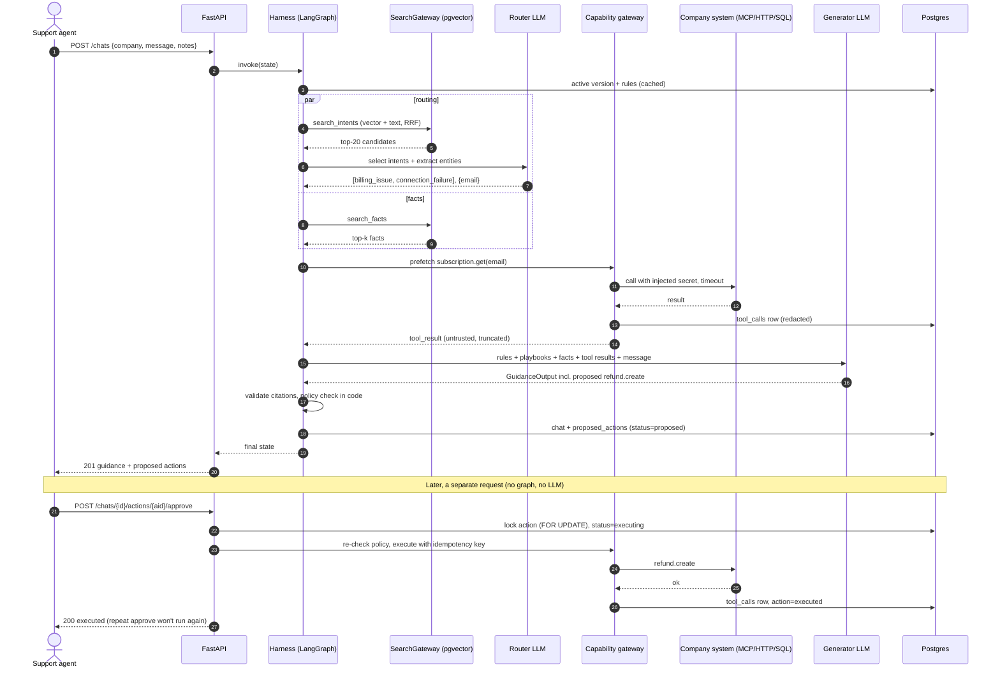

---

## 7. Hybrid intent routing

The router never sees the full intent list, only about 20 candidates. That is what lets this scale to hundreds of intents per company.

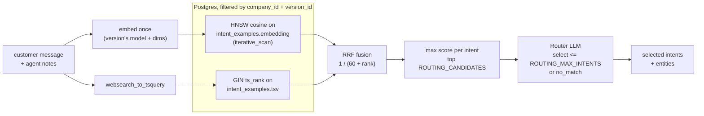

---

## 8. Capabilities and bindings

Playbook steps refer to abstract capabilities. Each company decides how, or whether, each one is implemented.

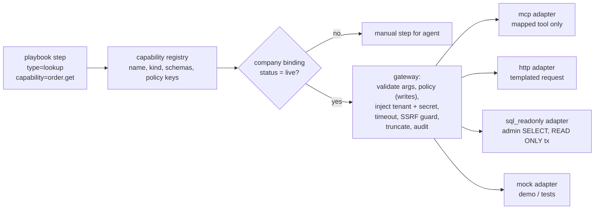

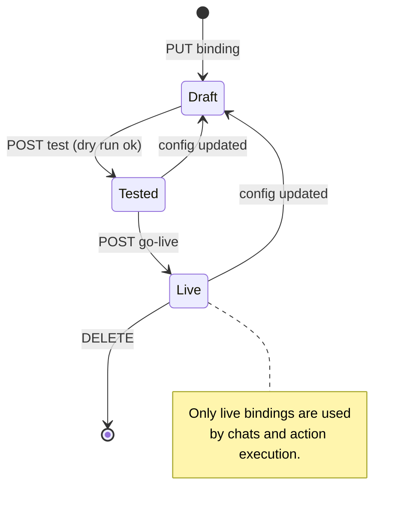

Proposed action lifecycle:

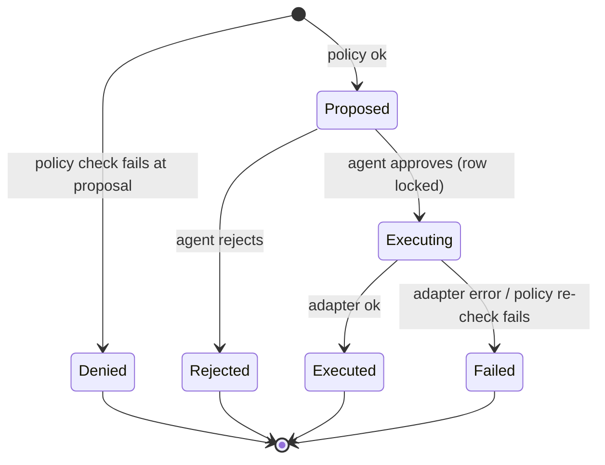

---

## 9. Data model

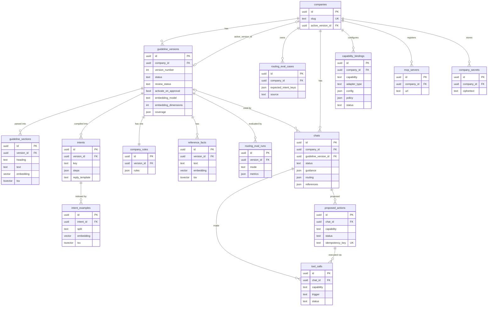

All playbook tables carry `company_id` + `version_id` and cascade on version delete, so deleting a version also deletes its vectors.

---

## 10. Deployment

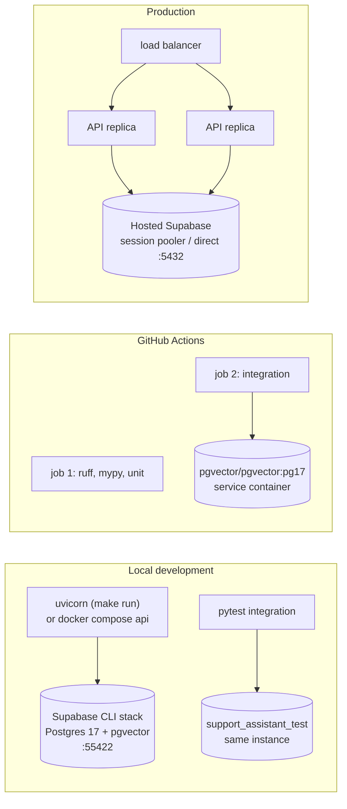

The API process is stateless (all state lives in Postgres), so it scales horizontally. Only env vars differ between environments.

---

## 11. Key decisions

| # | Decision | Why | Alternatives considered | Trade-off |
|---|---|---|---|---|
| 1 | **Compile guidelines into structured playbooks at upload** | Guidelines are runbooks for humans. Turning them into intents, typed steps, rules and facts makes routing exact, makes steps citable, and links steps to tools. | Plain RAG over chunks (v1) | Needs an LLM compile step plus validation; mistakes there need a coverage check and an optional human review |
| 2 | **pgvector in the same Postgres; Chroma removed** | One store, one transaction, one backup. Tenant and version filters in SQL; cascade deletes. Hundreds of intents per company is small for pgvector. | Chroma, a dedicated vector DB | At very large scale, pgvector needs partitioning; `SearchGateway` keeps a swap possible |
| 3 | **Hybrid search (vector + full-text, RRF)** | Embeddings miss product names, codes and exact phrasing; keyword search catches them | Vector only | Two queries per search; both indexed and cheap |
| 4 | **Embed synthetic example messages per intent; score by best match** | Customer wording rarely matches an intent's name or description | Embedding the intent description | More rows and embedding cost at ingest |
| 5 | **Two-stage routing: search candidates, then a cheap LLM selects** | Scales to hundreds of intents (the router sees about 20); handles messages with several intents and no-match | Single classifier over all intents; vector top-1 | One extra (fast) LLM call per chat |
| 6 | **Company rules always injected, never retrieved** | Tone, sign-off and prohibitions apply to every reply; retrieval could drop them | Retrieve as chunks | Slightly larger prompt |
| 7 | **Reference facts as a separate retrieval index** | Prices, device lists and URLs aren't procedures and don't map to steps | Folding facts into intents | A second search per chat (runs in parallel) |
| 8 | **Stable intent keys across versions** | Metrics, evals, feedback and history stay comparable after re-uploads | New keys per version | Compiler must be given previous keys; covered by a test |
| 9 | **Immutable versions; single active pointer on `companies`** | Exactly one active version, instant rollback with no re-indexing | `is_active` flag on versions | Activation needs a row lock (`FOR UPDATE`) |
| 10 | **Auto-approve by default, gated by a retrieval eval** | Zero friction for normal uploads, but a poor compile doesn't go live silently | Always manual review; always auto | Gate threshold needs tuning per domain |
| 11 | **Routing evals keyed by intent key, run per version** | Lets you compare v1 and v2 before a rollback; agent feedback becomes test data | Ad-hoc manual testing | Synthetic cases can be easier than real traffic, which feedback cases offset |
| 12 | **Abstract capabilities + per-company bindings (MCP / HTTP / read-only SQL / mock)** | Guidelines stay vendor-neutral; companies go live with zero integrations and add automation one binding at a time | Hard-coded vendor APIs; giving the model a whole MCP server | Admins must map tools to capabilities and test each binding |
| 13 | **Reads automatic, writes only as approved proposals** | Side effects stay under human control; the harness executes once with an idempotency key | Letting the model execute writes | One extra click for the agent |
| 14 | **Policy enforced in code, at proposal and at execution** | Prompts can be bypassed; code can't | Policy in the prompt | Policy keys must exist in the capability registry |
| 15 | **Read-only SQL only via admin-defined, parameterized SELECTs** | Reaches company databases without model-written SQL or write risk | Text-to-SQL | Each query must be defined up front |
| 16 | **Graceful degradation everywhere** | A broken or missing integration turns a step into a manual step instead of failing the chat; only an LLM failure returns 502 | Failing the request | Guidance may be less automated, never unavailable |
| 17 | **LangGraph for the chat harness, run in-process** | Branching, a bounded tool loop, parallel nodes and per-node tracing in one place; no extra service | Hand-written orchestration; LangGraph Platform | New dependency; nodes kept as plain functions to limit coupling |
| 18 | **No LangGraph checkpointer; approval is a separate deterministic request** | Paused graph state would have to live for minutes in storage; executing an approved action needs no LLM | `interrupt()` + Postgres checkpointer | The graph can't resume a conversation (multi-turn is out of scope) |
| 19 | **Ingestion is a plain async function, not a graph** | It's linear; plain code is simpler and moves to a worker queue unchanged | LangGraph for ingestion | None significant |
| 20 | **Alembic owns the schema; Supabase only hosts it** | One migration history for local, CI and prod; CI can use plain pgvector Postgres | Supabase migrations / Studio | Supabase-specific features aren't used |
| 21 | **Secrets encrypted (Fernet) behind `SecretStore`; injected at call time** | Credentials never reach prompts, logs or the audit table | Plaintext config | Key management via env var until KMS/Vault |
| 22 | **Everything external is untrusted data** | Customer messages, guidelines and tool output are all delimited and can't change instructions (prompt-injection defence) | — | Prompt is a bit more verbose |
| 23 | **LangSmith tracing off by default** | Tracing would send customer messages and tool data to a third party | Always on | Opt-in through env vars when debugging |

### Out of scope (future work)
Multi-turn threads, SSO/RBAC, a queue worker, multilingual messages, PDF/DOCX/OCR parsers (the interface exists), native OAuth connectors (Shopify, Stripe, Zendesk) and OpenAPI import, KMS/Vault, per-company tool rate limits, cross-encoder re-ranking, LLM-judge reply evals, partitioning by company, streaming responses.
